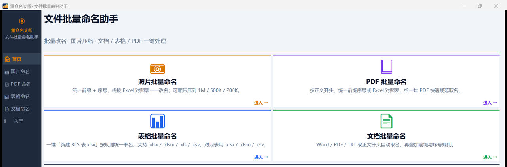

<p align="center">
  
</p>

# 重命名大师 · RenameMaster

> **纯本地**的文件批量命名助手 —— 照片 / PDF / 表格 / 文档一键规范改名，顺带压缩图片。**不联网、不上传、输出隔离、可撤销。**

<p align="center">
  <a href="https://github.com/Mine1178/renamemaster/releases/latest"></a>
  <a href="https://github.com/Mine1178/renamemaster/stargazers"></a>
  <a href="https://github.com/Mine1178/renamemaster/issues"></a>
  
  
  
</p>

**⬇️ 直接下载**：[最新版 Release](https://github.com/Mine1178/renamemaster/releases/latest) · [安装版 `RenameMaster_Setup.exe`](https://github.com/Mine1178/renamemaster/releases/download/v1.10.2/RenameMaster_Setup.exe) · [便携版 ZIP](https://github.com/Mine1178/renamemaster/releases/download/v1.10.2/RenameMaster_v1.10.2_Portable.zip)

---

## 为什么用它

| 日常痛点 | 重命名大师的做法 |
| --- | --- |
| 一堆照片 / 文档名字乱七八糟 | 统一前缀 + 序号，或按 Excel 对照表一一改名；**执行前先看新旧文件名预览表** |
| 怕把原文件改坏、改错 | 输出到独立文件夹，**绝不原地覆盖**；支持跨重启撤销最近一次批次 |
| 照片太大传不上去 | 二分法调 JPEG 质量，压不到目标再等比缩分辨率；可选保留 EXIF / 备份原图 |
| 文件名要按项目 / 日期 / 拍摄时间排 | 支持 `{date}` `{mtime}` `{exif}` `{parent}` `{stem}` 变量、自定义排序与查找替换 |

**全部处理在本机完成，不需要联网，账号和文件都不会离开这台电脑。**

## 界面预览



> v1.10.2 真实软件截图（为保护隐私，已裁去含本机私有路径的「最近使用」区域）。左侧 6 项导航，首页 4 张功能卡。

---

## 一、功能说明

| 模块 | 说明 |
| --- | --- |
| 📷 照片命名 | 统一前缀 + 序号；或按 Excel 对照表一一改名；可选图片压缩（1M / 500K / 200K / 100K），压不到再等比缩分辨率；保留 EXIF、备份原图可选。 |
| 📕 PDF 命名 | 按正文开头、统一前缀序号或 Excel 对照表批量改名；基于 pypdf 提取正文，自动跳过加密 / 空文本文件。 |
| 📊 表格命名 | 一堆「新建 XLS 表.xlsx」按规则统一取名；支持 `.xlsx` / `.xlsm` / `.xls` / `.csv`，对照表同格式。 |
| 📄 文档命名 | Word / PDF / TXT 取正文开头自动取名，再叠加前缀与序号规则。 |

**通用能力**：执行前预览新旧文件名对照表 · 输出隔离绝不原地覆盖 · 跨重启撤销 · 高级选项（命名变量 / 自定义排序 / 查找替换）· 文件列表右键移出 · 文件夹拖入 · 表格与文字可拖选复制。

**快捷键**：`Ctrl+O` 选源目录 · `Ctrl+Enter` 预览 / 执行 · `Esc` 关弹窗 / 取消执行。

## 二、安装与运行

### 安装版（推荐）
下载 `RenameMaster_Setup.exe` 双击安装，自动生成「重命名大师」快捷方式。

### 便携版
解压 `RenameMaster_v1.10.2_Portable.zip`（内含 `RenameMaster.exe` 与使用说明），直接运行，无需安装、无需联网。

> 系统要求：Windows 10 / 11。安装包与主程序均为单文件分发，不依赖 Python 环境。
> 首次运行若被 SmartScreen 拦截，点「更多信息」→「仍要运行」（未做代码签名，属正常）。

## 三、使用方法

1. 左侧导航选择功能页（照片 / PDF / 表格 / 文档），选源文件夹或拖入文件。
2. 设定规则：**统一前缀 + 序号**（前缀、位数、起始值、分隔符）或 **Excel 对照表**（原文件名 → 新文件名，重名与非法字符自动标色）。
3. 需要时展开「高级选项」设置命名变量、自定义排序、查找替换；照片页可选压缩档位。
4. 点「预览」核对，确认后「开始执行」；结果输出到 `<源目录>_重命名输出\`，随时可撤销。

完整说明见 [USER_MANUAL.md](USER_MANUAL.md)。

## 四、适用场景

- 行政 / 工程资料归档：成批图纸、合同、扫描件按项目编号统一命名；
- 摄影 / 电商：一批照片按「前缀 + 序号」规范取名并压到指定体积；
- 财务 / 人事：导出的报表、单据按 Excel 对照表批量对齐编号；
- 任何「文件名不能原样交出去」的场合 —— 输出隔离保证原件零风险。

## 五、赞助与反馈

觉得好用，可在应用内「关于」页点「☕ 赞助作者」，用微信 / 支付宝请作者喝杯咖啡。

- 问题反馈 / 功能建议：[Issues](https://github.com/Mine1178/renamemaster/issues)
- 完整手册：[USER_MANUAL.md](USER_MANUAL.md)（含版本记录）

## 六、开发、构建与打包

### 环境
Python 3.10+（已验证 3.10.14）；依赖 `Pillow` `openpyxl` `python-docx` `pypdf` `tkinterdnd2` `pyinstaller`，见 `requirements.txt`。

```bash
python -m rename_master.main          # 开发态运行
python tests\run_all.py -v           # 全量回归
```

### 生产打包
```bash
pyinstaller RenameMaster.spec         # 单文件 EXE（已排除 cv2 / numpy 等可选依赖）
iscc installer/rename_master.iss      # Inno Setup 安装包（需 iscc 在 PATH）
python build_manual_pdf.py            # 由手册源生成 docx / html / pdf
```

产物：`dist/RenameMaster.exe`、`dist/RenameMaster_Setup.exe`、便携版 ZIP。

## 七、版本历史

当前 **v1.10.2**（2026-11-05）：文件列表支持右键删除单条 / 多选（仅移除列表，不动磁盘文件）；高级选项排序与查找替换合并为一行；界面视觉规范统一、首页孤行控制、长说明自动换行；修复查找替换路径越界、非图片扩展名被误改、预览输出目录快照、后台线程异常导致界面卡住、UTF-32 BOM 对照表、多目录拖放等缺陷；打包剥离 numpy / fontTools 等可选依赖显著减小体积。

历史版本见 [USER_MANUAL.md](USER_MANUAL.md) 第 8 节。

## 八、许可

仓库当前**未附带 LICENSE 文件**，授权范围以作者说明为准。如需商用、二次分发或二次开发，请先通过 [Issues](https://github.com/Mine1178/renamemaster/issues) 与作者确认。

## 九、目录结构（核心）

```
src/rename_master/
├── main.py                 # 入口
├── ui/
│   ├── app.py              # 主窗口框架（左导航 + 右内容区）
│   ├── theme.py            # 全局配色 / 间距 / 字号规范
│   ├── widgets.py          # Card / PageHeader / 按钮工厂 / Treeview 工具
│   └── pages/              # home / photo / pdf / spreadsheet / document / about
├── core/                   # renamer / mapper / scanner / history ...
└── config/manager.py       # JSON 配置（%APPDATA%\RenameMaster\config.json）
```

---

© 2026 · 重命名大师 · 本地工具，数据不出本机。
